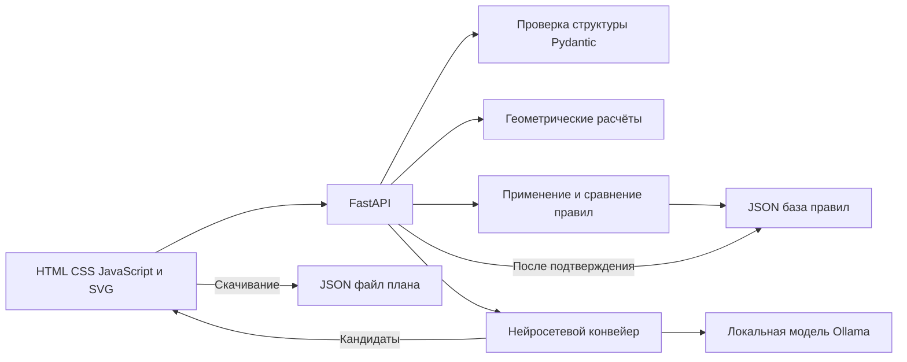

# Архитектура приложения

## Компоненты

Сервер FastAPI обслуживает интерфейс и JSON API. Uvicorn принимает локальные HTTP-запросы. Pydantic проверяет входные данные и ответы модели. Интерфейс реализован без сборщика и использует SVG для отображения геометрии.



| Файл | Назначение |
|---|---|
| `app/main.py` | HTTP-маршруты, выдача интерфейса, чтение и запись базы правил |
| `app/models.py` | Схемы данных и валидация |
| `app/geometry.py` | Контуры, пересечения, принадлежность и расстояния |
| `app/rules.py` | Условия, исключения и отношения между правилами |
| `app/neural.py` | Клиент Ollama, промпты и порядок этапов |
| `static/index.html`, `style.css`, `app.js` | Русскоязычный интерфейс и редактор |
| `evaluation/evaluate.py` | Запуск и оценка двух конвейеров |
| `scripts/prepare_data.py` | Создание синтетических данных; перезапись текущей базы |
| `scripts/smoke_api.py` | Проверка работающего HTTP-сервера |
| `scripts/package_project.py` | Создание архива исходников |

## Формат плана

Версия формата — `schema_version: 1`. Корневые поля: `name`, `parcels`, `objects`, `utilities`, `settings`.

| Сущность | Основные поля |
|---|---|
| Участок | `id`, `name`, `role`, `vertices` |
| Объект | `id`, `type`, `name`, `parcel_id`, `x`, `y`, `width`, `height`, `angle`, `attributes` |
| Коммуникация | `id`, `type`, `name`, `parcel_id`, `points` |
| Настройки | `grid_step`, `snap`, `show_neighbors`, `show_labels` |

Идентификаторы уникальны в пределах плана. Один участок имеет роль `own`; остальные — `neighbor`. Ссылки `parcel_id` должны указывать на существующий участок.

Участок задан простым многоугольником. Последняя вершина не повторяет первую. Объект задан центром, локальными размерами и углом. `height` означает глубину проекции, а `attributes.height_m` — физическую высоту. Ось X направлена вправо, ось Y — вниз. Положительный угол задаёт поворот по часовой стрелке.

Все контуры объектов прямоугольные. Для деревьев и кустов размеры описывают условную проекцию кроны. SVG и сервер используют одинаковую геометрию.

Коммуникации имеют тип `electricity`, `gas`, `sewer` или `water`. Ломаная содержит минимум две точки. Её принадлежность участку не ограничивает координаты линии.

## Ограничения формата

- Не более 16 участков, 150 объектов и 80 коммуникаций.
- Участок содержит от 3 до 60 вершин. Линия содержит от 2 до 60 точек.
- Координаты находятся в диапазоне от −1000 до 1000 м.
- Размеры объекта больше нуля и не превышают 200 м. Угол находится в диапазоне от −360° до 360°.
- Числа должны быть конечными. Неизвестные поля, версии и ссылки отклоняются.
- Повторяющиеся вершины, самопересечения и наложение соседних рёбер участка отклоняются.

Эти ограничения заданы схемами приложения. Они не являются строительными требованиями.

## Хранение и состояние интерфейса

План скачивается в JSON и проверяется сервером при загрузке. Дополнительная копия хранится в `localStorage`. История изменений находится в памяти браузера и ограничена 80 записями.

База правил хранится в `data/rules.json`. Запись выполняется через временный файл с последующей заменой под блокировкой. План и база правил сохраняются отдельно. Формат базы описан в [RULES.md](RULES.md).

После изменения плана или базы результаты проверки сбрасываются. Загруженный план не содержит текущего масштаба и результатов проверки. Масштаб формируется при отображении; проверка запускается пользователем.

## Геометрические расчёты

Локальные вершины прямоугольника имеют координаты `(±width/2, ±height/2)`. Для угла θ выполняется преобразование:

```text
x' = x + dx cos θ − dy sin θ
y' = y + dx sin θ + dy cos θ
```

Расстояние между объектами определяется по их заполненным контурам. Для каждой пары рёбер проверяются пересечение, касание и наложение. При отсутствии пересечения вычисляются проекции концов отрезков на другой отрезок. Параметр проекции ограничен интервалом от 0 до 1. Выбирается минимальная дистанция. При пересечении или вложении расстояние равно нулю.

Расстояние до границы вычисляется между рёбрами без обнуления при вложении. Поэтому объект внутри участка имеет положительный отступ. Если объект вышел за границу, проверка принадлежности даёт нарушение, а правило внутреннего отступа — недостаточность данных.

Для вогнутой границы проверяются вершины и рёбра объекта. Рёбра делятся точками пересечения с границей. Для каждого интервала проверяется его середина. Это выявляет выход через выемку при всех вершинах внутри участка.

Вычисления используют допуск `EPS = 1e-8`. Решение о соответствии принимается до округления для интерфейса. Геометрические сравнения имеют числовую погрешность; данный допуск не является нормативным допуском строительства.

Расстояние двух многоугольников вычисляется за `O(mn)`. Проверка пар прямоугольных объектов имеет сложность `O(N²)`. Пространственный индекс не реализован.

## Связанные документы

[API](API.md) описывает HTTP-маршруты. [RULES.md](RULES.md) описывает базу и проверку размещения. [NEURAL_METHOD.md](NEURAL_METHOD.md) описывает извлечение кандидатов. [VERIFICATION.md](VERIFICATION.md) содержит подтверждённые результаты проверок.
