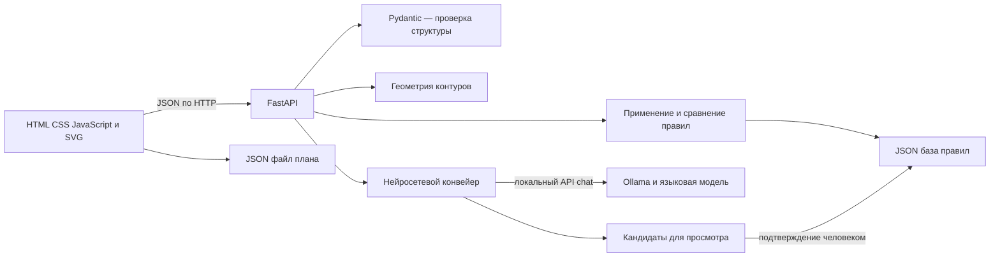

# Архитектура приложения

## Компоненты



| Файл | Назначение |
|---|---|
| `app/main.py` | HTTP API, интерфейс, чтение и атомарная запись базы правил |
| `app/models.py` | Версия формата, схемы и проверки входных данных/ответов модели |
| `app/geometry.py` | Контуры, пересечения, принадлежность, кратчайшие расстояния |
| `app/rules.py` | Условия/исключения, три результата проверки, сравнение правил |
| `app/neural.py` | Локальный транспорт Ollama, промпты и порядок этапов |
| `static/index.html`, `style.css`, `app.js` | Русский интерфейс и SVG редактор |
| `evaluation/evaluate.py` | Настоящие вызовы модели и оценка двух конвейеров |
| `scripts/prepare_data.py` | Воспроизводимое создание синтетических примеров; сбрасывает текущую базу |
| `scripts/smoke_api.py` | Проверка работающего HTTP-сервера |
| `scripts/package_project.py` | ZIP разрешённых материалов и контрольные суммы |

Сервер запускается на `127.0.0.1`. Нет базы данных, облака, авторизации, Docker или JavaScript-сборщика. Сторонние библиотеки — FastAPI, Uvicorn и используемый FastAPI Pydantic. Остальные алгоритмы используют стандартную библиотеку Python.

## Модель плана

`schema_version = 1`. План содержит `name`, `parcels`, `objects`, `utilities`, `settings`. Идентификаторы уникальны во всём плане. Ровно один участок имеет роль `own`; остальные — `neighbor`. Максимумы: 16 участков, 150 объектов, 80 коммуникаций, 60 точек в контуре/линии. Числа конечны; координаты от −1000 до 1000 м. Размеры объекта от 0 (не включительно) до 200 м. Незнакомые поля, версия, неизвестные ссылки и самопересечения отклоняются.

Участок — простой многоугольник `vertices: [{x,y}, ...]`. Последнюю вершину не повторяют. Форма может быть вогнутой. Объекты хранят тип, название, `parcel_id`, центр `x/y`, размеры `width/height` в локальных осях, `angle` и словарь `attributes`. Высота постройки хранится отдельно как `attributes.height_m`; `height` означает глубину её проекции на план.

Все расчётные контуры объектов — прямоугольники. Значение проекции растения/колодца является модельным приближением, которое видно в интерфейсе. SVG использует те же центр, размеры и угол, что и сервер. Начало координат и направление осей соответствуют экрану: X вправо, Y вниз.

Коммуникация — тип, название, принадлежность участку и минимум две точки ломаной. Полилиния не обязана лежать внутри назначенного участка. Параметры сетки, привязки, видимости соседей и подписей сохраняются с планом; текущий масштаб и результаты проверок пересчитываются после загрузки.

Основное хранение планов — скачиваемый JSON. Сервер валидирует данные перед сохранением/загрузкой; пользовательское имя файла не используется как путь на сервере. Копия в `localStorage` служит удобным восстановлением. История плана — до 80 изменений в памяти браузера. Проверка устаревает при изменении геометрии/базы.

## Геометрические расчёты

Вершины прямоугольника: локальные пары `(±width/2, ±height/2)`. После поворота на θ и переноса центра:

```text
x' = x + dx cos θ − dy sin θ
y' = y + dx sin θ + dy cos θ
```

Для каждой пары рёбер проверяется пересечение, включая касание и наложение. При отсутствии пересечения кратчайшая дистанция — минимум расстояний от концов одного отрезка до проекций на другой. Параметр проекции ограничивается от 0 до 1. Контуры, которые пересекаются или вложены, имеют расстояние 0.

Дистанция до границы вычисляется между рёбрами контуров без проверки вложения: это позволяет измерить положительный отступ объекта внутри участка. При проверке отступа сначала проверяется полная принадлежность участка; у вышедшего наружу объекта геометрия даёт нарушение, а правило внутреннего отступа — недостаточно данных.

Для вогнутого участка недостаточно проверить вершины объекта. Алгоритм делит каждое ребро объекта точками пересечения с границей и проверяет середины полученных интервалов. Так выявляется пересечение выемки даже при четырёх вершинах внутри участка. Самопересечение и наложение соседних рёбер участка отклоняются. Числовая погрешность сравнений — `EPS = 1e-8` м; округление результатов для интерфейса происходит после решения о соответствии.

Сложность расстояния двух многоугольников `O(mn)`, где m/n — число рёбер. Проверка всех пар объектов — `O(N²)` с прямоугольниками по четыре ребра. Предназначено для небольшого учебного плана; пространственный индекс не реализован.

## Правила

Правило содержит ID, название, типы роли `a`/`b`, параметр, оператор, число/единицу (допускаются отсутствующие у неподдерживаемого кандидата), область `scope`, структурированные условия, исключения, их текст, `unresolved`, исходную цитату, источник, статус просмотра и активность. Активность и статус кандидата — разные поля.

Типы: `house`, `garage`, `bathhouse`, `outbuilding`, `septic`, `cesspit`, `well`, `bed`, `greenhouse`, `shrub`, `tree`; специальный `boundary` обозначает границу назначенного участка. Неизвестные понятия сохраняются в кандидате, но не активируются вычислителем.

| Параметр | Проверяемая величина |
|---|---|
| `distance` | Кратчайшая дистанция заполненных контуров a/b |
| `boundary_distance` | Отступ контура a от границы его участка; `types_b=["boundary"]` |
| `height_m` | Числовая характеристика высоты a; `types_b=[]` |

Метры, сантиметры и миллиметры приводятся к метрам. `scope`: любые участки; один участок; разные участки; прилегающие участки. Прилегание определяется касанием их границ в пределах EPS, без кадастровой/правовой интерпретации.

Условие: `{"target":"a","field":"material","operator":"==","value":"wood"}`. Условия — конъюнкция, исключения — дизъюнкция. `None`, отсутствующее поле или несовместимый тип значения приводят к недостаточности данных. Ложное условие исключает применение правила; сработавшее исключение исключает применение даже при неизвестном другом условии. bool не используется как числовое значение. Сложные неразобранные условия препятствуют активации.

Результат проверки: `violation`, `complies`, `insufficient_data`; объекты, числа, оператор, единицы, условия, объяснение, источник и точки кратчайшего отрезка. Геометрическая целостность помечена как отдельное учебное предупреждение. Любое касание/вложение объектов показывается как пересечение; допустимость совмещения по смыслу объектов оценивает человек.

Сравнение правил описано отдельно в методе. Активное правило должно иметь статус `confirmed`, поддерживаемую структуру и установленный источник. Для `normative` обязательны документ, редакция, пункт, URL и подтверждение человеком. Это проверка метаданных, а не автоматическая юридическая экспертиза. JSON база записывается через временный файл и замену под блокировкой.

## Основные маршруты API

| Метод и путь | Назначение |
|---|---|
| `GET /api/health`, `/api/example` | Работоспособность и пример |
| `POST /api/plan/validate` | Проверка/нормализация всего плана |
| `POST /api/measure` | Любая пара точек, контуров или границ |
| `POST /api/check` | Геометрия и активная база; можно передать базу явно |
| `GET /api/rules` | Текущая база |
| `POST /api/rules/relations` | Проверка взаимосвязей без записи |
| `POST /api/rules/confirm` | Просмотренное правило включается после проверки |
| `POST /api/rules/import` | Явная замена базы после проверки |
| `GET /api/ai/status`, `POST /api/ai/analyze` | Статус и нейросетевое извлечение |
| `GET /api/dataset` | Синтетический корпус |

Интерактивное описание API: `http://127.0.0.1:8000/docs`. Ошибки данных дают HTTP 422 с русским общим объяснением и указанием полей, дубли/конфликты — 409, недоступная модель — 503, неправильный ответ модели — 502. Планировщик остаётся работоспособным при ошибке анализа.
